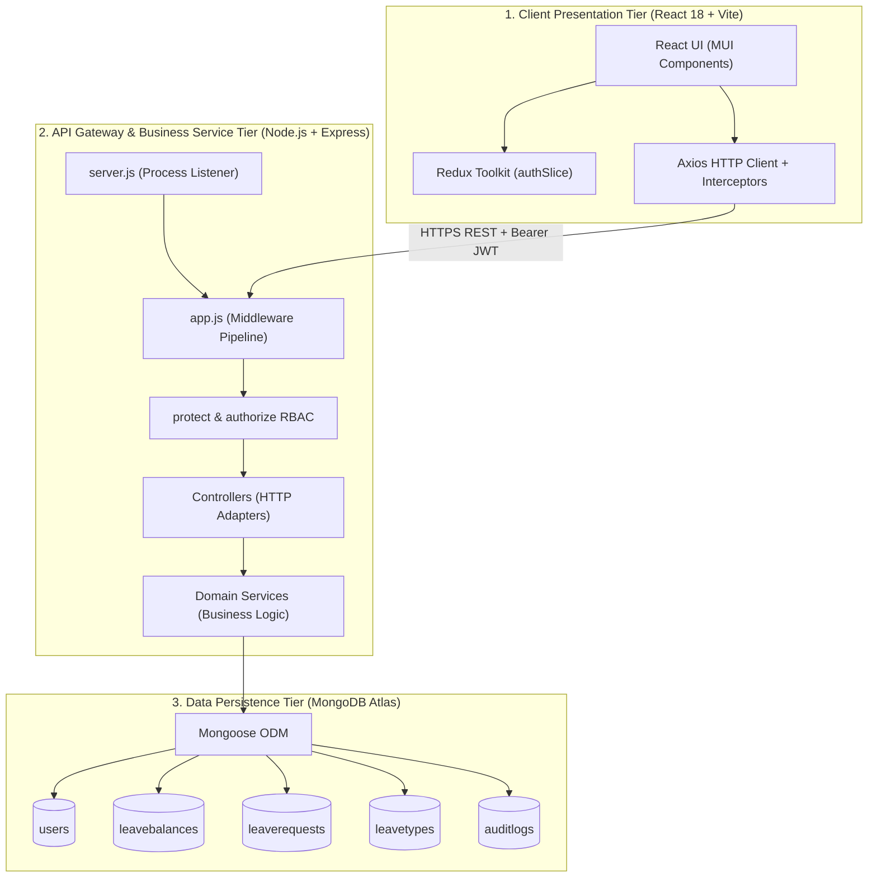

# LEAVE MANAGEMENT SYSTEM (LMS)
## Master End-to-End Project Documentation & Team Presentation Guide

> **Project Classification**: Full-Stack Enterprise Web Application (MERN Stack)  
> **Evaluation Event**: Semester 5 Full Stack Web Development Final Evaluation & Viva  
> **Team Members & Ownership**:
> - **Nithilan**: Lead System Architect, Core Authentication & Employee Vertical
> - **Muskan**: Manager Vertical & Workflow Approval Engine
> - **Mohnish**: HR / Administrator Vertical, Enterprise Reporting & DevOps  
> **Tech Stack**: MongoDB Atlas · Express.js · React 18 (Vite + MUI) · Node.js · Redux Toolkit · Docker · Swagger UI · Jest

---

## TABLE OF CONTENTS

1. [Section 1: Employee Role (End-to-End) — Nithilan's Domain & Scope](#section-1-employee-role-end-to-end--nithilans-domain--scope)
   - 1.1 Persona, Objectives & Scope
   - 1.2 Implemented Features & User Workflows
   - 1.3 Complete Code Files Breakdown (What Each File Does)
   - 1.4 Business Rules, Edge Cases & Mathematical Validations
   - 1.5 Individual Live Demo Walkthrough (Step-by-Step)
   - 1.6 Viva Defense Questions & Model Answers
2. [Section 2: Manager Role (End-to-End) — Muskan's Domain & Scope](#section-2-manager-role-end-to-end--muskans-domain--scope)
   - 2.1 Persona, Objectives & Scope
   - 2.2 Implemented Features & User Workflows
   - 2.3 Complete Code Files Breakdown (What Each File Does)
   - 2.4 Business Rules, Edge Cases & Departmental Boundaries
   - 2.5 Individual Live Demo Walkthrough (Step-by-Step)
   - 2.6 Viva Defense Questions & Model Answers
3. [Section 3: HR / Administrator Role (End-to-End) — Mohnish's Domain & Scope](#section-3-hr--administrator-role-end-to-end--mohnishs-domain--scope)
   - 3.1 Persona, Objectives & Scope
   - 3.2 Implemented Features & User Workflows
   - 3.3 Complete Code Files Breakdown (What Each File Does)
   - 3.4 Business Rules, Edge Cases & Data Integrity Guardrails
   - 3.5 Individual Live Demo Walkthrough (Step-by-Step)
   - 3.6 Viva Defense Questions & Model Answers
4. [Section 4: Master Top-to-Bottom System Architecture & Unified Walkthrough](#section-4-master-top-to-bottom-system-architecture--unified-walkthrough)
   - 4.1 Executive Overview & Problem Space
   - 4.2 3-Tier Layered Architecture & Component Interaction
   - 4.3 Database Schema & Data Dictionary (All 5 Collections)
   - 4.4 Complete Request-Response Lifecycle (From Click to DB)
   - 4.5 Security Architecture: Cryptography, JWT, RBAC & Audit Trails
   - 4.6 Complete Project Directory Tree & File Responsibility Matrix
   - 4.7 10-Minute Seamless Team Presentation Script (Joint Flow)
   - 4.8 Master Viva Defense Q&A (General Full-Stack Questions)
   - 4.9 Quick Start & Execution Guide (Running Locally & Seeding)

---

# SECTION 1: EMPLOYEE ROLE (END-TO-END) — Nithilan's Domain & Scope

```
+-------------------------------------------------------------------------------------------------+
|                                 EMPLOYEE VERTICAL AT A GLANCE                                   |
+-------------------------------------------------------------------------------------------------+
| Contributor       | Nithilan                                                                    |
| Demo Account      | employee@ssn.com  / Password: 123                                           |
| Primary Screens   | Employee Dashboard, Apply Leave, My Leave Requests, Holiday Calendar        |
| Core Operations   | View Balance Quotas, Submit Leave Application, Cancel Pending Requests       |
| Primary Backend   | leaveController.js, leaveService.js, leaveRoutes.js, User.js, LeaveBalance.js|
| Critical Safety   | Virtual Pending Hold Formula (prevents concurrent over-subscription)        |
+-------------------------------------------------------------------------------------------------+
```

### 1.1 Persona, Objectives & Scope
The **Employee** persona represents regular staff members who need transparent, real-time visibility into their time-off entitlements and a friction-free workflow to apply for leaves without administrative confusion.

- **Primary Scope**:
  1. Real-time balance visibility across all assigned leave types (Casual, Sick, Earned).
  2. Intelligent application form that computes duration in calendar days and checks balance availability before allowing submission.
  3. Live tracking of submitted requests (`PENDING`, `APPROVED`, `REJECTED`, `CANCELLED`).
  4. Self-service cancellation of requests that are still in `PENDING` state.
  5. Viewing organizational holidays to plan leaves efficiently.

---

### 1.2 Implemented Features & User Workflows
1. **Dynamic Dashboard (`/`)**:
   - Displays real-time KPI cards for every leave type showing **Total Quota**, **Days Used**, and **Remaining Days**.
   - Pulls data directly from `/api/leaves/balances`, backed by Mongoose virtual properties.
   - Shows recent request history table with status color badges (Yellow for Pending, Green for Approved, Red for Rejected, Grey for Cancelled).
2. **Interactive Leave Application (`/apply`)**:
   - Dropdown dynamically populated with active leave types from `/api/leaves/balances`.
   - Date range pickers for Start Date and End Date.
   - Instant dynamic calculation of days requested: `(endDate - startDate) / (1000 * 60 * 60 * 24) + 1`.
   - Dynamic client-side warning if requested days exceed remaining available balance.
   - Reason input field (mandatory).
   - Instant feedback via success/error toast notifications.
3. **My Requests Tracking & Management (`/my-requests`)**:
   - Comprehensive tabular display of all requests submitted by the logged-in user.
   - Columns: Leave Type, Start Date, End Date, Total Days, Status, Manager Review Comment, Applied Date, Actions.
   - **Cancel Action**: If a request is `PENDING`, a red "Cancel" button is available. When clicked, it prompts confirmation, transitions status to `CANCELLED`, releases the virtual hold, and logs the cancellation.
4. **Holiday Calendar (`/holidays`)**:
   - Displays all statutory and organizational holidays with date, holiday name, and day of week.
   - Fetched from `/api/holidays`.

---

### 1.3 Complete Code Files Breakdown (What Each File Does)

#### Frontend Files (Employee Vertical)
| File Path | Role & Exact Functionality | Key Functions / Hooks Used |
|---|---|---|
| `client/src/pages/Dashboard.jsx` | **Employee Home Screen**: Renders balance summary cards (Casual, Sick, Earned) and quick list of recent requests. Fetches data on mount. | `useEffect`, `useSelector`, `axiosInstance.get('/api/leaves/balances')`, `get('/api/leaves/my-requests')` |
| `client/src/pages/ApplyLeave.jsx` | **Leave Submission Form**: Controlled React form with live date math, client-side quota validation, submission handler, and error alert rendering. | `useState`, `useNavigate`, `handleDateChange`, `handleSubmit`, `axiosInstance.post('/api/leaves/apply')` |
| `client/src/pages/MyRequests.jsx` | **Request History & Cancellation**: Table of past and current requests with status badges. Triggers cancellation API for pending leaves. | `handleCancel`, `axiosInstance.put('/api/leaves/:id/cancel')`, MUI `Chip`, `Table`, `Dialog` |
| `client/src/pages/HolidayCalendar.jsx` | **Statutory Calendar**: Reads and displays public holidays with calendar styling and chronological ordering. | `useEffect`, `axiosInstance.get('/api/holidays')`, MUI `List`, `ListItem` |
| `client/src/components/employeeNav.js` | **Role Navigation Items**: Exports the navigation links specifically tailored for employees: Dashboard, Apply Leave, My Requests, Holiday Calendar. | Configuration array with labels, routes, and MUI icons |

#### Backend Files (Employee Vertical)
| File Path | Role & Exact Functionality | Key Code Logic & Methods |
|---|---|---|
| `server/routes/leaveRoutes.js` | **Employee Route Router**: Mounts endpoints for leave operations. Secures every route with `protect` and `authorize('employee', 'manager', 'hr')`. | `router.post('/apply')`, `router.get('/my-requests')`, `router.get('/balances')`, `router.put('/:id/cancel')` |
| `server/controllers/leaveController.js` | **HTTP Adapter Layer**: Extracts authenticated user ID from `req.user._id`, parses body parameters, calls service layer, and returns HTTP responses (200, 201, 400). | `applyForLeave`, `getMyRequests`, `getMyBalances`, `cancelRequest` |
| `server/services/leaveService.js` | **Business Logic Engine (Employee portion)**: Authoritative validation of dates, calculates working days, performs over-subscription pending quota checks, creates request record, appends audit log, and triggers email. | `applyForLeave()`, `getAvailableDays()`, `getMyLeaveRequests()`, `getMyBalances()`, `cancelLeaveRequest()` |
| `server/models/LeaveBalance.js` | **Balance Persistence Model**: Stores per-user, per-leave-type quotas. Features compound unique index on `{ user: 1, leaveType: 1 }` and virtual `remaining = total - used`. | Mongoose schema with `total`, `used`, virtual getter for `remaining` |
| `server/models/LeaveRequest.js` | **Leave Record Schema**: Defines structure of leave submissions. Tracks `employee`, `leaveType`, `startDate`, `endDate`, `days`, `reason`, `status`, and `reviewedBy`. | Enums: `['PENDING', 'APPROVED', 'REJECTED', 'CANCELLED']`, index on `{ employee: 1, status: 1 }` |
| `server/controllers/holidayController.js` & `server/routes/holidayRoutes.js` | **Holiday API**: Delivers structured JSON array of company holidays to frontend components. | `getHolidays` controller returning static list of statutory holidays |

---

### 1.4 Business Rules, Edge Cases & Mathematical Validations

#### The Over-Subscription Vulnerability & Virtual Pending Hold
- **Problem**: An employee has 3 days remaining. They apply for 2 days from Oct 10 to Oct 11. While that request is pending, they submit another request for 2 days from Oct 14 to Oct 15. If balance deduction only happens on approval, both requests would pass the check `requestedDays <= remaining` (since `2 <= 3` both times), leading to 4 days used against a 3-day quota once approved!
- **Nithilan's Solution (`getAvailableDays`)**:
  ```javascript
  // server/services/leaveService.js
  const pendingRequests = await LeaveRequest.find({
    employee: userId,
    leaveType: leaveTypeId,
    status: 'PENDING',
  });
  const pendingDays = pendingRequests.reduce((sum, req) => sum + req.days, 0);
  const availableDays = balance.remaining - pendingDays;
  if (requestedDays > availableDays) {
    throw new Error(`Insufficient leave balance. You have ${balance.remaining} days remaining, but ${pendingDays} days are already held in pending requests.`);
  }
  ```

#### Chronological Date Validations
1. **Start Date >= Today**: Employee cannot apply for leaves in the past.
2. **End Date >= Start Date**: Prevents negative day math.
3. **No Overlapping Dates**: Checks whether the employee already has an active (`PENDING` or `APPROVED`) leave request overlapping with the requested `[startDate, endDate]` interval.

---

### 1.5 Individual Live Demo Walkthrough (Step-by-Step)
1. Navigate to `http://localhost:5173/login`.
2. Click the **"Employee"** quick-fill card (fills `employee@ssn.com` / `123`) and click **Sign In**.
3. **Point out Dashboard**: Highlight the KPI cards showing Casual Leave (12 Total, 0 Used, 12 Remaining).
4. Click **"Apply for Leave"** in the sidebar.
5. Select **"Casual Leave"**, set Start Date = tomorrow, End Date = day after tomorrow (2 days). Show that the form displays **"Duration: 2 Days"**.
6. Enter Reason: *"Family function"* and click **Submit**.
7. Point out the toast: *"Leave request submitted successfully"*.
8. Navigate to **"My Leave Requests"**: Show the new entry sitting at status `PENDING` with a yellow badge.
9. Open **MongoDB Compass**:
   - Inspect `leaverequests`: New document exists with `status: 'PENDING'`.
   - Inspect `leavebalances`: Notice `used` is still `0` (correct: balance is not deducted until approval).
   - Inspect `auditlogs`: Immutable entry created with `action: 'LEAVE_APPLIED'`.

---

### 1.6 Viva Defense Questions & Model Answers
- **Q1: Why do you calculate the available days using pending requests instead of deducting balance immediately on application?**
  - *Answer*: "If we deducted the balance immediately upon submission and the manager later rejected or cancelled the request, we would need compensating transactions to refund the balance, introducing race conditions. Instead, we hold the days virtually during pending state (`remaining - pendingDays`) and execute the atomic deduction `balance.used += days` strictly upon formal approval."
- **Q2: Why is date validation performed on both the React frontend and the Express backend?**
  - *Answer*: "Frontend date validation improves user experience by giving instant feedback without network latency. However, client-side code can be bypassed using Postman or curl. Under our Zero-Trust architecture, the backend service re-validates that `startDate <= endDate`, dates are in the future, and no overlapping requests exist."
- **Q3: How does Mongoose calculate `remaining` days without storing it as a database column?**
  - *Answer*: "In `models/LeaveBalance.js`, we defined a Mongoose virtual property `remaining` with a getter `function() { return this.total - this.used; }`. This avoids data inconsistency (storing derived data that could get out of sync with `total` and `used`)."

---

# SECTION 2: MANAGER ROLE (END-TO-END) — Muskan's Domain & Scope

```
+-------------------------------------------------------------------------------------------------+
|                                  MANAGER VERTICAL AT A GLANCE                                   |
+-------------------------------------------------------------------------------------------------+
| Contributor       | Muskan                                                                      |
| Demo Account      | nithilan7437@gmail.com  / Password: 123                                     |
| Primary Screens   | Manager Approval Queue (/manager), Team Request History                     |
| Core Operations   | Review Team Requests, Approve Leave (Deduct Quota), Reject Leave (Comment) |
| Primary Backend   | managerController.js, managerRoutes.js, leaveService.js, AuditLog.js       |
| Critical Safety   | Departmental Reporting Boundary Enforcement ({ manager: req.user._id })    |
+-------------------------------------------------------------------------------------------------+
```

### 2.1 Persona, Objectives & Scope
The **Manager** persona represents team leads, engineering managers, and department heads responsible for reviewing time-off requests submitted by their direct reports, ensuring operational coverage, and making binding approval or rejection decisions.

- **Primary Scope**:
  1. Department-bounded visibility: Managers can only see and act upon requests from employees who report to them directly (`employee.manager === req.user._id`).
  2. Single-click Approval workflow that atomically deducts employee leave balance and transitions status to `APPROVED`.
  3. Controlled Rejection workflow that enforces mandatory review comments so employees understand why time off was denied.
  4. Real-time notifications and full audit logging of manager actions.

---

### 2.2 Implemented Features & User Workflows
1. **Manager Approval Queue (`/manager`)**:
   - Tabular view of all incoming `PENDING` leave requests submitted by direct reports.
   - Shows Employee Name, Department, Leave Type, Date Range, Duration in Days, Reason, and Action Buttons.
   - Dynamic badge showing the total count of pending requests awaiting action.
2. **Approve Workflow**:
   - Clicking **"Approve"** opens a confirmation modal (`ConfirmDialog.jsx`) summarizing the employee name and requested dates.
   - Upon confirmation, calls `PUT /api/manager/requests/:id/approve`.
   - The backend atomically increments `used` days in `LeaveBalance`, updates request status to `APPROVED`, timestamps `reviewedAt`, tags `reviewedBy`, writes an immutable `AuditLog` entry, and sends an approval email to the employee.
   - Row updates optimistically in the UI.
3. **Reject Workflow**:
   - Clicking **"Reject"** opens a dialog requiring a **Review Comment / Rejection Reason**.
   - Manager cannot submit rejection without typing a reason (prevents uninformative rejections).
   - Calls `PUT /api/manager/requests/:id/reject`.
   - Transitions status to `REJECTED`, stores comment, leaves balances intact, records `AuditLog`, and sends rejection email.
4. **Self-Service Dual Role**:
   - Managers are also employees! The manager navigation includes links to apply for their own leave and view their personal requests.

---

### 2.3 Complete Code Files Breakdown (What Each File Does)

#### Frontend Files (Manager Vertical)
| File Path | Role & Exact Functionality | Key Functions / Hooks Used |
|---|---|---|
| `client/src/pages/manager/ApprovalQueue.jsx` | **Manager Review Dashboard**: Displays list of pending requests for the manager's team. Hosts Approve and Reject modals, comment entry state, and status chips. | `useState`, `useEffect`, `fetchRequests`, `handleApprove`, `handleReject`, `Dialog`, `TextField` |
| `client/src/components/managerNav.js` | **Manager Navigation Definition**: Configures the navigation drawer for managers: Approval Queue, Apply Leave (self), My Requests (self), Holiday Calendar. | Exported route configuration array with Manager badge icons |
| `client/src/components/ConfirmDialog.jsx` | **Action Confirmation Modal**: Generic reusable modal for confirming critical actions (such as irreversible approval or cancellation) before network dispatch. | Props: `open`, `title`, `message`, `onConfirm`, `onClose` |

#### Backend Files (Manager Vertical)
| File Path | Role & Exact Functionality | Key Code Logic & Methods |
|---|---|---|
| `server/routes/managerRoutes.js` | **Manager Route Gateway**: Dedicated REST endpoints for team requests. Guarded with `protect` and `authorize('manager', 'hr')`. | `router.get('/requests')`, `router.put('/requests/:id/approve')`, `router.put('/requests/:id/reject')` |
| `server/controllers/managerController.js` | **Manager Request Handler**: Verifies manager identity from `req.user._id`, extracts params and comments, delegates to `leaveService`, and returns updated request. | `getPendingRequests`, `approveRequest`, `rejectRequest`, `getTeamHistory` |
| `server/services/leaveService.js` (Workflow Core) | **Approval & Rejection Execution Engine**: Queries direct reports, validates manager authority over employee, executes atomic balance deductions, updates request status, and appends audit logs. | `getTeamRequests()`, `approveLeaveRequest()`, `rejectLeaveRequest()` |
| `server/models/AuditLog.js` | **Immutable Audit Trail**: Append-only collection recording reviewer identity, action (`LEAVE_APPROVED`, `LEAVE_REJECTED`), previous status, new status, and review comments. | Mongoose schema with `user`, `action`, `details`, `timestamp` |
| `server/services/emailService.js` | **Workflow Notification Dispatcher**: Integrates Resend to notify manager upon application and employee upon approval or rejection. | `sendLeaveStatusNotification()` |

---

### 2.4 Business Rules, Edge Cases & Departmental Boundaries

#### Departmental & Reporting Hierarchy Enforcement
- **Security Rule**: A manager must NEVER be allowed to approve or reject requests for an employee who is not their direct report.
- **Muskan's Implementation**:
  ```javascript
  // server/services/leaveService.js -> approveLeaveRequest
  const request = await LeaveRequest.findById(requestId).populate('employee');
  if (reviewer.role === 'manager') {
    if (String(request.employee.manager) !== String(reviewer._id)) {
      throw createError('Forbidden: You are not authorized to approve requests for this employee.', 403);
    }
  }
  ```
  *Even if a malicious manager attempts to call `PUT /api/manager/requests/<other-employee-request-id>/approve` directly via Postman, the backend asserts the manager relationship and returns a 403 Forbidden!*

#### Concurrency & Double-Approval Protection
- **Rule**: If a request has already been approved, rejected, or cancelled, no manager or concurrent request can alter its state again.
- **Check**:
  ```javascript
  if (request.status !== 'PENDING') {
    throw createError(`Cannot process request. Current status is already ${request.status}`, 400);
  }
  ```

#### Atomic Balance Deduction
- **Execution**:
  ```javascript
  const balance = await LeaveBalance.findOne({
    user: request.employee._id,
    leaveType: request.leaveType,
  });
  balance.used += request.days;
  await balance.save();
  ```

---

### 2.5 Individual Live Demo Walkthrough (Step-by-Step)
1. Log out from Employee and return to `http://localhost:5173/login`.
2. Click the **"Manager"** card (fills `nithilan7437@gmail.com` / `123`) and click **Sign In**.
3. Point out that the manager is redirected to `/manager` (**Approval Queue**).
4. Show that Emma's 2-day Casual Leave request appears in the table with reason *"Family function"*.
5. Explain the boundary check: *"Notice only my direct reports appear here. Employees from other departments are filtered out."*
6. Click the green **"Approve"** button. The confirmation dialog appears.
7. Click **Confirm**:
   - Row updates to `APPROVED` with a green chip.
   - An email is triggered to the employee.
8. Switch to **MongoDB Compass**:
   - Inspect `leavebalances` for Emma: `used` has incremented from `0` to `2`! `remaining` is now `10`.
   - Inspect `leaverequests`: `status` is now `APPROVED`, `reviewedBy` contains the Manager's ObjectId, `reviewedAt` is timestamped.
   - Inspect `auditlogs`: Second immutable audit entry exists with `action: 'LEAVE_APPROVED'`.

---

### 2.6 Viva Defense Questions & Model Answers
- **Q1: What prevents a manager from approving a request for an employee who reports to another manager?**
  - *Answer*: "We enforce authorization at the database service layer in `leaveService.js`. When the request is fetched, we populate the `employee` document. If the reviewer has the role `manager`, we strictly assert `request.employee.manager.toString() === req.user._id.toString()`. If they do not match, we throw a 403 Forbidden exception."
- **Q2: What happens if an employee cancels their leave request right before the manager clicks approve?**
  - *Answer*: "The approval method checks `if (request.status !== 'PENDING')`. If the employee cancelled it a millisecond earlier, its status is already `CANCELLED`, so the manager's approval fails immediately with a 400 Bad Request error, preventing corrupt state or unauthorized balance deduction."
- **Q3: Why is rejection comment made mandatory?**
  - *Answer*: "From an HR compliance and organizational perspective, arbitrary leave denial creates workplace friction. Our form and backend both validate `if (!reviewComment?.trim()) throw new Error('A rejection reason is mandatory')`, ensuring transparency."

---

# SECTION 3: HR / ADMINISTRATOR ROLE (END-TO-END) — Mohnish's Domain & Scope

```
+-------------------------------------------------------------------------------------------------+
|                                    HR VERTICAL AT A GLANCE                                      |
+-------------------------------------------------------------------------------------------------+
| Contributor       | Mohnish                                                                     |
| Demo Account      | hr@ssn.com  / Password: 123                                                 |
| Primary Screens   | HR Dashboard, Manage Users, Leave Types / Policies, Enterprise Reports      |
| Core Operations   | User Provisioning, Quota Policy Propagation (bulkWrite), MongoDB Analytics  |
| Primary Backend   | userController.js, leaveTypeController.js, reportService.js, Docker/CI     |
| Critical Safety   | Self-deactivation guard, Native MongoDB Aggregations ($O(1) Memory)         |
+-------------------------------------------------------------------------------------------------+
```

### 3.1 Persona, Objectives & Scope
The **HR / Administrator** persona has organizational authority across all personnel, system configurations, leave policies, compliance reporting, and infrastructure orchestration.

- **Primary Scope**:
  1. Organizational User Provisioning & Hierarchy Management: Onboarding employees, assigning managers, assigning roles (`employee`, `manager`, `hr`), and account deactivation.
  2. Leave Policy Governance: Creating statutory leave types, defining annual quotas, and propagating balance allocations organization-wide.
  3. Enterprise Analytics & Regulatory Reporting: Running high-performance MongoDB aggregation pipelines to track utilization, department trends, and streaming CSV compliance exports.
  4. DevOps & Cloud Readiness: Docker containerization, multi-stage production builds, OpenAPI 3.0 Swagger specifications, and automated CI pipelines.

---

### 3.2 Implemented Features & User Workflows
1. **Executive HR Dashboard (`/hr`)**:
   - Metric cards: **Total Active Employees**, **Pending Approvals**, **Approved Leaves This Month**, **Active Leave Types**.
   - High-level overview of organizational time-off health.
2. **User Management & Hierarchy Governance (`/hr/users`)**:
   - Complete directory table of all employees, managers, and HR staff.
   - Shows Name, Email, Department, Role, Reporting Manager, Active Status, and Actions.
   - **Add User Modal**: Full form with Name, Email, Password, Role, Department, and Manager dropdown.
   - **Edit User**: Modify role or re-assign reporting manager.
   - **Soft Deactivation**: Toggle account active state (`isActive: false`), immediately invalidating login access without deleting historical leave records.
3. **Leave Policy & Quota Management (`/hr/leave-types`)**:
   - Management table for leave policies: Casual, Sick, Earned, Maternity, Paternity, etc.
   - **Add Policy**: Define Name, Annual Quota (days), and Description.
   - **Batch Allocation (`bulkWrite`)**: Automatically allocates new leave balances to all existing users using a single batched database operation.
4. **Enterprise Reports, Charts & CSV Export (`/hr/reports`)**:
   - Graphical visualizations: Monthly leave volume bar chart and Department-wise distribution breakdown.
   - Full regulatory Audit Log browser displaying all actions performed across the system.
   - **Export CSV Button**: Streams leave history into a downloadable `.csv` file for external payroll/compliance auditing.
5. **Global Approval Override (`/hr/approvals`)**:
   - Allows HR to view company-wide pending requests and override approvals if a manager is absent.

---

### 3.3 Complete Code Files Breakdown (What Each File Does)

#### Frontend Files (HR Vertical)
| File Path | Role & Exact Functionality | Key Functions / Hooks Used |
|---|---|---|
| `client/src/pages/hr/HRDashboard.jsx` | **Executive Overview**: Loads headline metrics, pending counts, and system status indicators. | `useEffect`, `axiosInstance.get('/api/reports/dashboard')`, MUI `Card`, `Typography` |
| `client/src/pages/hr/ManageUsers.jsx` | **User Administration Portal**: Directory listing, Add/Edit User modal, role promotion dropdown, manager assignment, and deactivate toggle. | `useState`, `useEffect`, `handleCreateUser`, `handleToggleStatus`, MUI `Dialog`, `Switch` |
| `client/src/pages/hr/LeaveTypes.jsx` | **Policy Management Portal**: Create and modify leave types and annual quotas. Triggers organization-wide quota propagation. | `handleCreateType`, `handleUpdateQuota`, `axiosInstance.post('/api/leave-types')` |
| `client/src/pages/hr/Reports.jsx` | **Analytics & Audit Ledger**: Displays monthly trends, department usage tables, paginated audit logs, and handles CSV export. | `fetchReportData`, `handleDownloadCSV`, `axiosInstance.get('/api/reports/export', { responseType: 'blob' })` |
| `client/src/pages/hr/Approvals.jsx` | **Global Leave Queue**: Company-wide view of all pending requests across all departments for administrative review. | `fetchGlobalPending`, `handleOverrideApprove` |
| `client/src/components/hrNav.js` | **HR Navigation Drawer**: Comprehensive links for HR: Dashboard, Manage Users, Leave Policies, Reports, Global Approvals, Apply Leave, My Requests. | Navigation configuration array with administrative icons |

#### Backend & DevOps Files (HR Vertical)
| File Path | Role & Exact Functionality | Key Code Logic & Methods |
|---|---|---|
| `server/routes/userRoutes.js` & `server/controllers/userController.js` | **User Management REST API**: Full CRUD endpoints for users, password resets, role assignment, and soft deactivation. | `getUsers`, `createUser`, `updateUser`, `deactivateUser` guarded by `authorize('hr')` |
| `server/services/userService.js` | **User Governance Logic**: Enforces email uniqueness, hashes passwords, validates manager references, and prevents HR self-deactivation. | `createUserService()`, `updateUserService()`, `toggleUserStatus()` |
| `server/routes/leaveTypeRoutes.js` & `server/controllers/leaveTypeController.js` | **Leave Policy API**: Endpoints for policy creation, quota adjustments, and active policy queries. | `getLeaveTypes`, `createLeaveType`, `updateLeaveTypeQuota` |
| `server/services/leaveTypeService.js` | **Policy Business Engine**: Prevents duplicate leave type names (case-insensitive regex), validates quotas > 0, and handles deletion safety. | `createType()`, `updateQuota()` |
| `server/services/balanceService.js` | **High-Performance Batch Allocation**: Uses MongoDB `bulkWrite` to bulk insert or update leave balances across all employees when a policy changes. | `bulkWrite([ { insertOne: { document: ... } } ])` |
| `server/routes/reportRoutes.js` & `server/controllers/reportController.js` | **Reporting Endpoints**: Serves aggregation metrics, audit log data, and streams generated CSV files with appropriate MIME headers. | `getDashboardMetrics`, `getAuditLogs`, `exportCSV` |
| `server/services/reportService.js` | **MongoDB Aggregation Engine**: Advanced pipelines (`$match`, `$group`, `$lookup`, `$project`) computing department metrics, monthly trends, and CSV string generation. | `getMonthlyTrends()`, `getDepartmentBreakdown()`, `generateCSV()` |
| `server/config/swagger.js` | **OpenAPI 3.0 Documentation**: Complete interactive API documentation for all 30+ endpoints accessible via `/api/docs`. | `swaggerJSDoc`, `swaggerUi.serve` |
| `Dockerfile`, `client/Dockerfile`, `docker-compose.yml` | **Containerization Orchestration**: Multi-stage Docker builds for client and server, interconnected on a private bridge network with MongoDB. | Multi-stage Node/Nginx containers, health checks, environment injection |

---

### 3.4 Business Rules, Edge Cases & Data Integrity Guardrails

#### Self-Deactivation Guard
- **Problem**: If an HR admin inadvertently deactivates their own account, the system could be left with no active administrator to manage users.
- **Mohnish's Guard (`userService.js`)**:
  ```javascript
  if (req.user._id.toString() === targetUserId.toString()) {
    throw createError('Security Violation: Administrators cannot deactivate their own account.', 400);
  }
  ```

#### High-Performance Batch Allocation (`bulkWrite`)
- **Problem**: When a new leave type (e.g., "Paternity Leave" — 15 days) is introduced in a company with 1,000 employees, using a loop with `LeaveBalance.create()` sends 1,000 individual network round-trips to MongoDB, taking 10–15 seconds and risking mid-way failures.
- **Mohnish's Solution (`balanceService.js`)**:
  ```javascript
  const operations = users.map(user => ({
    updateOne: {
      filter: { user: user._id, leaveType: newLeaveTypeId },
      update: { $setOnInsert: { total: annualQuota, used: 0 } },
      upsert: true,
    }
  }));
  await LeaveBalance.bulkWrite(operations);
  ```
  *Executes in a single atomic network payload directly on the MongoDB engine in < 50 milliseconds!*

#### Memory-Efficient Native MongoDB Aggregations
- **Problem**: Calculating monthly trends by pulling all 50,000 leave requests into Node.js memory and using `.filter()` or `.reduce()` can crash the Node.js process with `JavaScript heap out of memory`.
- **Mohnish's Solution**: Execute the computation directly inside the MongoDB C++ core engine using `$match`, `$group`, and `$project`, returning only the final compact statistical payload.

---

### 3.5 Individual Live Demo Walkthrough (Step-by-Step)
1. Log out from Manager and return to `http://localhost:5173/login`.
2. Click the **"HR"** card (fills `hr@ssn.com` / `123`) and click **Sign In**.
3. **Show HR Dashboard (`/hr`)**: Highlight organizational metrics (Total Employees, Active Leave Types, Approved leaves).
4. Navigate to **"Manage Users" (`/hr/users`)**:
   - Point out the user table showing Emma, Mike, and HR Admin.
   - Explain the hierarchy: Emma's manager column shows "Manager Mike".
   - Demonstrate the Add User form with role and manager assignment.
5. Navigate to **"Leave Policies" (`/hr/leave-types`)**:
   - Show Casual (12), Sick (10), Earned (15).
   - Explain how `bulkWrite` automatically allocates these balances to all new employees.
6. Navigate to **"Reports & Analytics" (`/hr/reports`)**:
   - Showcase the Monthly Trends bar graph and Departmental distribution.
   - Show the live **Audit Logs table**: Point out the exact audit records created during Nithilan's and Muskan's steps earlier (`LEAVE_APPLIED` by Emma, `LEAVE_APPROVED` by Mike)!
   - Click **"Export to CSV"**: Browser downloads `leave_report.csv`. Open it to show real formatted data.
7. Open **Swagger UI** in a new tab: `http://localhost:5000/api/docs` to demonstrate interactive OpenAPI 3.0 documentation.

---

### 3.6 Viva Defense Questions & Model Answers
- **Q1: Why did you use MongoDB aggregation pipelines instead of JavaScript array methods in Node.js?**
  - *Answer*: "Processing thousands of records in Node.js loads large amounts of raw JSON into RAM, causing memory bloat and blocking the single-threaded Event Loop. MongoDB aggregation pipelines execute natively within MongoDB's C++ database engine using database indexes. Only the final aggregate summary (e.g. 10 numbers) is transmitted over the network."
- **Q2: How does `bulkWrite` improve performance when adding a leave type for all employees?**
  - *Answer*: "Instead of opening 1,000 separate HTTP/TCP sockets and round-trips with `LeaveBalance.create()`, `bulkWrite` groups all 1,000 operations into a single serialized BSON command sent to MongoDB in one network trip, reducing execution time from seconds to milliseconds."
- **Q3: What happens to historical leave requests if an employee is deactivated?**
  - *Answer*: "We implement soft deactivation (`isActive: false`) rather than hard deletion (`deleteUser`). This prevents the user from logging in, but completely preserves referential integrity: all past leave requests, approvals, and audit records remain intact for labor compliance and tax auditing."

---

# SECTION 4: MASTER TOP-TO-BOTTOM SYSTEM ARCHITECTURE & UNIFIED WALKTHROUGH

```
+-------------------------------------------------------------------------------------------------+
|                                FULL SYSTEM ARCHITECTURE OVERVIEW                                |
+-------------------------------------------------------------------------------------------------+
| Architectural Pattern | 3-Tier Layered Architecture (Client SPA -> API Gateway -> MongoDB)      |
| Authentication        | Cryptographic JWT (HMAC-SHA256) + bcryptjs (10 Salt Rounds)             |
| Authorization         | Multi-Tier Role-Based Access Control (RBAC: Employee, Manager, HR)      |
| State Management      | Redux Toolkit (authSlice) + Local React Hook State                      |
| API Documentation     | OpenAPI 3.0 Specification via Swagger UI (/api/docs)                    |
| Containerization      | Docker Multi-Stage Builds + Docker Compose Private Bridge Network       |
+-------------------------------------------------------------------------------------------------+
```

### 4.1 Executive Overview & Problem Space
The **Leave Management System (LMS)** replaces fragile, informal leave tracking methods (spreadsheets, emails, paper slips) with an enterprise-grade digital workflow engine.

#### The Three Core Flaws of Legacy Systems:
1. **The Over-Subscription Race Condition**: Employees submit multiple overlapping requests against a single quota balance.
2. **Authorization & Boundary Leakage**: Cross-departmental approvals or confidential health data exposed to unauthorized personnel.
3. **Audit Amnesia**: Lack of non-repudiation when leave disputes or compliance audits occur.

Our solution completely resolves these flaws through **virtual pending quota reservation**, **strict server-side reporting boundary checks**, and an **immutable append-only audit ledger**.

---

### 4.2 3-Tier Layered Architecture & Component Interaction



---

### 4.3 Database Schema & Data Dictionary (All 5 Collections)

```
+----------------------------------------------------------------------------------------------------+
|                                    DATABASE ENTITY-RELATIONSHIP MAP                                |
+----------------------------------------------------------------------------------------------------+
|                                                                                                    |
|    +----------------------+             +----------------------+            +-----------------+    |
|    |        User          | 1         * |     LeaveBalance     | *        1 |    LeaveType    |    |
|    |----------------------|-------------|----------------------|------------|-----------------|    |
|    | _id (ObjectId)       |             | _id (ObjectId)       |            | _id (ObjectId)  |    |
|    | name (String)        |             | user (Ref: User)     |            | name (String)   |    |
|    | email (String, Unique|             | leaveType (Ref)      |            | annualQuota(Num)|    |
|    | password (Hash)      |             | total (Number)       |            | description     |    |
|    | role (Enum)          |             | used (Number)        |            | isActive (Bool) |    |
|    | department (String)  |             | remaining (Virtual)  |            +-----------------+    |
|    | manager (Ref: User)  |             +----------------------+                                   |
|    | isActive (Boolean)   |                                                                        |
|    +----------------------+                                                                        |
|             | 1                                                                                    |
|             |                                                                                      |
|             | *                                                                                    |
|    +----------------------+             +----------------------+                                   |
|    |     LeaveRequest     |             |       AuditLog       |                                   |
|    |----------------------|             |----------------------|                                   |
|    | _id (ObjectId)       |             | _id (ObjectId)       |                                   |
|    | employee (Ref: User) |             | user (Ref: User)     |                                   |
|    | leaveType (Ref)      |             | action (String Enum) |                                   |
|    | startDate (Date)     |             | details (Object)     |                                   |
|    | endDate (Date)       |             | ipAddress (String)   |                                   |
|    | days (Number)        |             | timestamp (Date)     |                                   |
|    | reason (String)      |             +----------------------+                                   |
|    | status (Enum)        |                                                                        |
|    | reviewedBy (Ref)     |                                                                        |
|    | reviewComment (Str)  |                                                                        |
|    +----------------------+                                                                        |
+----------------------------------------------------------------------------------------------------+
```

#### Detailed Attribute Table
| Collection | Field Name | Data Type | Constraints & Defaults | Description |
|---|---|---|---|---|
| **`users`** | `_id` | ObjectId | Primary Key | Unique user identifier |
| | `name` | String | Required, Trim | Full name of employee |
| | `email` | String | Required, Unique, Lowercase | Corporate login email |
| | `password` | String | Required, `select: false` | bcrypt hashed password |
| | `role` | String | Enum: `['employee', 'manager', 'hr']` | RBAC access level |
| | `department` | String | Required | Organizational department |
| | `manager` | ObjectId | Ref: `User`, Optional | Direct reporting manager |
| | `isActive` | Boolean | Default: `true` | Soft deactivation flag |
| **`leavetypes`** | `_id` | ObjectId | Primary Key | Unique leave type ID |
| | `name` | String | Required, Unique | E.g. Casual, Sick, Earned |
| | `annualQuota` | Number | Required, Min: 1 | Default annual allocation |
| | `description` | String | Optional | Policy explanation |
| **`leavebalances`** | `_id` | ObjectId | Primary Key | Unique balance ID |
| | `user` | ObjectId | Required, Ref: `User` | Owner of the balance |
| | `leaveType` | ObjectId | Required, Ref: `LeaveType` | Associated leave policy |
| | `total` | Number | Required, Min: 0 | Total allocated days |
| | `used` | Number | Default: 0, Min: 0 | Total approved taken days |
| | *`remaining`* | *Virtual* | Computed: `total - used` | Dynamic available balance |
| **`leaverequests`**| `_id` | ObjectId | Primary Key | Unique request ID |
| | `employee` | ObjectId | Required, Ref: `User` | Submitting employee |
| | `leaveType` | ObjectId | Required, Ref: `LeaveType` | Requested leave category |
| | `startDate` | Date | Required | First day of leave |
| | `endDate` | Date | Required | Last day of leave |
| | `days` | Number | Required, Min: 1 | Total calendar days |
| | `reason` | String | Required | Justification text |
| | `status` | String | Enum: `PENDING`, `APPROVED`, `REJECTED`, `CANCELLED` | Current lifecycle state |
| | `reviewedBy` | ObjectId | Ref: `User`, Optional | Manager or HR who reviewed |
| | `reviewComment`| String | Optional (Mandatory on Reject) | Feedback note |
| **`auditlogs`** | `_id` | ObjectId | Primary Key | Ledger record ID |
| | `user` | ObjectId | Required, Ref: `User` | Actor who took action |
| | `action` | String | Required, Enum | E.g. `LEAVE_APPLIED`, `LEAVE_APPROVED` |
| | `details` | Object | Mixed JSON | Snapshot of changed data |
| | `timestamp` | Date | Default: `Date.now` | Immutable timestamp |

---

### 4.4 Complete Request-Response Lifecycle (From Click to DB)

Here is what happens under the hood when Emma submits a leave application:

1. **User Action**: Emma selects dates on `ApplyLeave.jsx` and clicks **"Submit"**.
2. **Client Validation**: React verifies `startDate <= endDate` and `requestedDays <= balance.remaining`.
3. **Axios Transport**: Axios retrieves the JWT token from `localStorage` or Redux store, injects `Authorization: Bearer <token>` header, and sends `POST /api/leaves/apply`.
4. **Network Ingestion (`server.js` & `app.js`)**:
   - Express applies CORS origin check and parses JSON body via `express.json()`.
5. **Security Gate (`authMiddleware.js`)**:
   - `protect`: Verifies JWT signature using `process.env.JWT_SECRET`. Decodes `{ id }`.
   - Queries `User.findById(decoded.id)`. Ensures `user.isActive === true`. Attaches to `req.user`.
   - `authorize('employee', 'manager', 'hr')`: Verifies `req.user.role` is authorized.
6. **Controller Dispatch (`leaveController.js`)**:
   - Extracts `{ leaveTypeId, startDate, endDate, reason }` from `req.body`.
   - Calls `leaveService.applyForLeave(req.user._id, data)`.
7. **Business Logic Execution (`leaveService.js`)**:
   - Computes calendar days: `(endDate - startDate) + 1`.
   - Checks for overlapping active requests in `leaverequests`.
   - Queries `LeaveBalance` for the user and leave type.
   - Computes virtual pending holds (`getAvailableDays`). Validates that `requestedDays <= availableDays`.
   - Calls `LeaveRequest.create({ ... })` with status `PENDING`.
   - Appends permanent audit record via `AuditLog.create({ action: 'LEAVE_APPLIED', ... })`.
   - Triggers asynchronous email dispatch to Emma's reporting manager.
8. **HTTP Response**: Controller returns `201 Created` with the JSON payload of the created request.
9. **UI Update**: Axios receives response, React triggers toast notification *"Request submitted successfully"*, and navigates to `/my-requests`.

---

### 4.5 Security Architecture: Cryptography, JWT, RBAC & Audit Trails
- **Password Salting & Hashing**: Handled via `bcryptjs` in a Mongoose `pre('save')` hook with cost factor 10. Passwords are never stored in plaintext and never returned in API responses (`select: false`).
- **Cryptographic JWT Tokens**: Signed using HMAC-SHA256 with a high-entropy secret (`JWT_SECRET`). Tokens carry minimal payload (`id`, `role`) and expire within 24 hours.
- **Two-Layer Route Guards**:
  - *Client Side*: `ProtectedRoute.jsx` checks Redux auth state; unauthorized users are redirected to `/login` or 403 pages.
  - *Server Side*: `protect` and `authorize` middleware authoritatively reject unauthorized HTTP requests with 401 or 403 status codes.
- **Append-Only Audit Trail**: Every sensitive state change (`APPLIED`, `APPROVED`, `REJECTED`, `CANCELLED`, `USER_CREATED`, `POLICY_UPDATED`) appends a document to `auditlogs`. No `update` or `delete` routes exist for audit logs.

---

### 4.6 Complete Project Directory Tree & File Responsibility Matrix

```
LMS/
├── client/                                    # Frontend React 18 Application (Vite)
│   ├── src/
│   │   ├── api/
│   │   │   └── axios.js                       # Axios instance with Bearer interceptors
│   │   ├── components/
│   │   │   ├── ConfirmDialog.jsx              # Reusable modal confirmation dialog
│   │   │   ├── Layout.jsx                     # Topbar, Sidebar & responsive layout shell
│   │   │   ├── ProtectedRoute.jsx             # React Router client-side role guards
│   │   │   ├── employeeNav.js                 # Navigation items for Employee role
│   │   │   ├── managerNav.js                  # Navigation items for Manager role
│   │   │   ├── hrNav.js                       # Navigation items for HR role
│   │   │   └── navForRole.js                  # Dynamic navigation switcher by role
│   │   ├── pages/
│   │   │   ├── ApplyLeave.jsx                 # [Nithilan] Employee leave application form
│   │   │   ├── Dashboard.jsx                  # [Nithilan] Employee KPI cards & overview
│   │   │   ├── HolidayCalendar.jsx            # [Nithilan] Statutory holiday calendar
│   │   │   ├── Login.jsx                      # [Nithilan] Authentication form & demo cards
│   │   │   ├── MyRequests.jsx                 # [Nithilan] Employee request tracking & cancel
│   │   │   ├── manager/
│   │   │   │   └── ApprovalQueue.jsx          # [Muskan] Manager review & approval dashboard
│   │   │   └── hr/
│   │   │       ├── Approvals.jsx              # [Mohnish] Global HR approval override queue
│   │   │       ├── HRDashboard.jsx            # [Mohnish] Executive overview & analytics
│   │   │       ├── LeaveTypes.jsx             # [Mohnish] Leave policy management & quotas
│   │   │       ├── ManageUsers.jsx            # [Mohnish] Employee directory & hierarchy
│   │   │       └── Reports.jsx                # [Mohnish] Chart analytics & CSV export
│   │   ├── store/
│   │   │   ├── slices/
│   │   │   │   └── authSlice.js               # Redux Toolkit authentication slice
│   │   │   └── store.js                       # Redux store configuration
│   │   ├── App.jsx                            # Route tree with ProtectedRoute wrapping
│   │   └── main.jsx                           # React DOM root entry point
├── server/                                    # Backend Node.js / Express.js Application
│   ├── config/
│   │   ├── db.js                              # Resilient MongoDB Atlas connection logic
│   │   └── swagger.js                         # OpenAPI 3.0 JSDoc specification
│   ├── controllers/
│   │   ├── authController.js                  # Login & credential verification
│   │   ├── holidayController.js               # Statutory holidays retrieval
│   │   ├── leaveController.js                 # [Nithilan] Employee leave endpoints
│   │   ├── managerController.js               # [Muskan] Manager queue & review endpoints
│   │   ├── leaveTypeController.js             # [Mohnish] Leave policy endpoints
│   │   ├── reportController.js                # [Mohnish] Dashboard metrics & CSV stream
│   │   └── userController.js                  # [Mohnish] User provisioning & role management
│   ├── middleware/
│   │   ├── authMiddleware.js                  # protect (JWT) & authorize (RBAC) gates
│   │   └── errorMiddleware.js                 # Centralized 404 & 500 JSON error handler
│   ├── models/
│   │   ├── AuditLog.js                        # Immutable append-only compliance ledger
│   │   ├── LeaveBalance.js                    # Per-user leave quotas with dynamic virtuals
│   │   ├── LeaveRequest.js                    # Leave applications with status enums
│   │   ├── LeaveType.js                       # Master leave policies & annual limits
│   │   └── User.js                            # User accounts, bcrypt hooks, manager link
│   ├── routes/
│   │   ├── authRoutes.js                      # /api/auth routes
│   │   ├── holidayRoutes.js                   # /api/holidays routes
│   │   ├── leaveRoutes.js                     # /api/leaves routes
│   │   ├── managerRoutes.js                   # /api/manager routes
│   │   ├── leaveTypeRoutes.js                 # /api/leave-types routes
│   │   ├── reportRoutes.js                    # /api/reports routes
│   │   └── userRoutes.js                      # /api/users routes
│   ├── services/
│   │   ├── balanceService.js                  # [Mohnish] High-performance bulkWrite batching
│   │   ├── emailService.js                    # Resend transactional email integration
│   │   ├── holidayService.js                  # Statutory holidays dataset
│   │   ├── leaveService.js                    # [Nithilan & Muskan] Core leave workflow engine
│   │   ├── leaveTypeService.js                # [Mohnish] Policy validation & unique checks
│   │   ├── reportService.js                   # [Mohnish] Native MongoDB aggregation pipelines
│   │   └── userService.js                     # [Mohnish] User CRUD & hierarchy validation
│   ├── app.js                                 # Express app configuration (testable)
│   ├── server.js                              # HTTP network socket listener & entry point
│   └── seed.js                                # Database seeder script for demo data
├── docker-compose.yml                         # Multi-container orchestration (App + DB)
├── Dockerfile                                 # Multi-stage production container
└── package.json                               # Workspace scripts & dependencies
```

---

### 4.7 10-Minute Seamless Team Presentation Script (Joint Flow)

| Time | Speaker | Visual / Screen Shown | Exact Spoken Script |
|---|---|---|---|
| **0:00 - 1:30** | **Nithilan** | Architecture Diagram / Title Slide | *"Good morning, respected evaluators. Today our team presents our Full-Stack Leave Management System. Our application is engineered on a 3-tier MERN stack with strict Role-Based Access Control dividing responsibilities across three distinct personas: Employee, Manager, and HR. Every business rule is isolated in a testable Service Layer, balance operations are mathematically locked, and every state change appends to an immutable audit ledger. I will begin by demonstrating our core architecture and the Employee vertical."* |
| **1:30 - 3:30** | **Nithilan** | Browser: Login -> Employee Dashboard -> Apply Leave | *"I log in as Employee Emma (`employee@ssn.com`). Notice the dynamic dashboard displaying current balance quotas: Emma has 12 days of Casual Leave. I navigate to 'Apply Leave' and select Casual Leave from tomorrow to day after tomorrow. The frontend immediately computes 2 calendar days. When I submit, the backend executes `getAvailableDays`, holding pending quotas virtually to prevent over-subscription. In 'My Requests', the leave sits at `PENDING`. In MongoDB Compass, `used` is still 0 because balance deduction only occurs upon approval."* |
| **3:30 - 4:00** | **Nithilan -> Muskan** | Screen Switch | *"Now, I hand over the demonstration to Muskan, who will demonstrate how our workflow engine processes this pending request in the Manager vertical."* |
| **4:00 - 6:00** | **Muskan** | Browser: Manager Login -> Approval Queue | *"Thank you, Nithilan. I log in as Manager Mike (`nithilan7437@gmail.com`), Emma's reporting manager. In my Approval Queue, Emma's request appears immediately. Notice that if an employee from another department had applied, they would not appear here because our backend strictly asserts `{ manager: req.user._id }`. I review Emma's reason, click 'Approve', and confirm. The state transitions to `APPROVED` and an email notification is dispatched to Emma."* |
| **6:00 - 6:45** | **Muskan** | MongoDB Compass | *"Looking at MongoDB Compass, we refresh `leavebalances`: notice that `used` has atomically updated from 0 to 2, and the dynamic virtual `remaining` is now 10! In `auditlogs`, an immutable entry records that Manager Mike approved the request. Now, Mohnish will demonstrate the HR Administrative, Reporting, and DevOps vertical."* |
| **6:45 - 8:45** | **Mohnish** | Browser: HR Login -> HR Dashboard & Reports | *"Thank you, Muskan. Logging in as HR Admin (`hr@ssn.com`), we have complete organizational oversight. In 'Manage Users', HR can onboard staff, assign reporting managers, and toggle account activation with defensive guards preventing HR from deactivating themselves. In 'Leave Policies', HR can adjust annual quotas, and our system uses MongoDB `bulkWrite` to propagate quotas across all employees in a single atomic batch. In 'Reports', our system runs native MongoDB aggregation pipelines to visualize monthly trends, department usage, and stream a compliance CSV export."* |
| **8:45 - 10:00** | **Mohnish** | Swagger UI / Terminal / Docker | *"Under the hood, our application is fully containerized using Docker and Docker Compose. We have documented all 30+ endpoints with OpenAPI 3.0 Swagger UI, and automated CI tests validate the integrity of every route on every commit. We are now open for questions."* |

---

### 4.8 Master Viva Defense Q&A (General Full-Stack Questions)

#### 1. Why did you choose the MERN stack for this project?
- **Answer**: "The MERN stack provides single-language homogeneity (JavaScript across client, server, and database queries), non-blocking asynchronous I/O via Node.js, flexible JSON document storage in MongoDB, and a declarative, reactive component hierarchy in React 18."

#### 2. Why is `server.js` separated from `app.js`?
- **Answer**: "Separating `app.js` from `server.js` decouples Express route/middleware configuration from the HTTP network listener. This allows automated integration test frameworks (like Supertest) to import `app.js` and run fast, in-memory HTTP assertions without binding to a network socket or causing port collision issues during testing."

#### 3. How do you handle authentication persistence across page refreshes in React?
- **Answer**: "Upon successful login, the JWT token and user profile are saved to `localStorage` and synchronized with the Redux `authSlice`. When the application initializes in `main.jsx`, the store hydrates user state from `localStorage`. Our Axios request interceptor dynamically injects this token into the `Authorization: Bearer` header of every outgoing request."

#### 4. How does your system prevent race conditions when two managers review a request simultaneously?
- **Answer**: "In `leaveService.js`, the approval logic explicitly validates `if (request.status !== 'PENDING') throw createError('Request is no longer pending', 400)`. Once the first manager's request commits, the document status transitions to `APPROVED`. Any concurrent or subsequent request reads the updated status and aborts immediately."

#### 5. Why do you use Mongoose virtuals instead of saving `remaining` directly in MongoDB?
- **Answer**: "`remaining` is derived data (`total - used`). Storing derived data in a database introduces the risk of data anomalies where `remaining` could diverge from `total - used` due to partial updates. By defining a Mongoose virtual getter, `remaining` is dynamically calculated on-the-fly, ensuring 100% mathematical consistency."

---

### 4.9 Quick Start & Execution Guide (Running Locally & Seeding)

#### 1. Prerequisites
- Node.js >= 18.x
- MongoDB Atlas connection string or local MongoDB instance (`mongodb://localhost:27017/lms`)

#### 2. Server Setup & Database Seeding
```bash
# Navigate to server directory
cd server

# Install dependencies
npm install

# Configure environment variables in .env
# PORT=5000
# MONGO_URI=your_mongodb_atlas_uri
# JWT_SECRET=your_jwt_secret_key
# CLIENT_URL=http://localhost:5173

# Wipe and reseed starter accounts and balances
node seed.js --fresh

# Start backend development server
npm run dev
# Server runs on: http://localhost:5000
# Swagger API docs: http://localhost:5000/api/docs
```

#### 3. Client Setup & Launch
```bash
# In a new terminal, navigate to client directory
cd client

# Install dependencies
npm install

# Start Vite React development server
npm run dev
# Client runs on: http://localhost:5173
```

#### 4. Running with Docker Compose (Single Command)
```bash
# In root directory
docker-compose up --build
# Spins up Client, API Server, and MongoDB on an isolated container network
```

#### 5. Default Demo Credentials
| Role | Email | Password | Assigned Manager |
|---|---|---|---|
| **Employee** | `employee@ssn.com` | `123` | Manager Mike |
| **Manager** | `nithilan7437@gmail.com` | `123` | - |
| **HR Admin** | `hr@ssn.com` | `123` | - |

---
*End of Master Document — Prepared for SEM 5 Full Stack Web Development Project Defense.*
